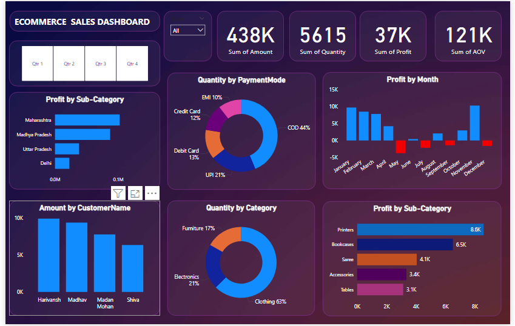

# 🛒 E-Commerce Sales Analytics: Revenue, Profitability & Customer Insights Dashboard

A dynamic, interactive Power BI data visualization tool built to track retail sales performance, regional profitability, customer purchasing behavior, and payment mode trends across quarterly e-commerce operations.

---

## Short Description / Purpose

The **E-Commerce Sales Dashboard** is a visually engaging and analytical Power BI report designed to help retail managers and business analysts evaluate sales revenue, order quantities, net profitability, and Average Order Value (AOV) across Indian states and product categories. The dashboard highlights critical commercial metrics—such as Q4 performance (`118K` sales amount, `1,409` units sold, `12K` profit, and `33K` AOV), payment mode preferences, top-spending customers, and monthly profit swings—enabling data-driven inventory, marketing, and regional expansion decisions.

---

## Tech Stack

The dashboard was built using the following tools and technologies:

* 📊 **Power BI Desktop** – Main data visualization platform used for dark-theme executive report design and interactive storytelling.
* 📂 **Power Query** – Data transformation and cleaning layer for merging order details and list-of-orders tables, handling data types, and standardizing fields.
* 🧠 **DAX (Data Analysis Expressions)** – Used for calculated measures (`Sum of Amount`, `Sum of Quantity`, `Sum of Profit`, `Sum of AOV`) and conditional formatting (highlighting negative monthly profit).
* 📝 **Data Modeling & Interactivity** – Relational modeling between Orders and Order Details tables with cross-filtering slicers for **Quarter** (`Qtr 1`–`Qtr 4`) and **State**.
* 📁 **File Format** – `.pbix` for Power BI development and `.png` for dashboard previews.

---

## Data Source

* **Source:** Indian E-Commerce Retail Orders Dataset (Orders & Order Details tables).
* **Structure:** Transactional e-commerce dataset capturing Order IDs, Order Dates (segmented by Quarter and Month), Customer Names, States across India, Product Categories (`Clothing`, `Electronics`, `Furniture`), Sub-Categories (`Printers`, `Saree`, `Chairs`, `Trousers`, `Stole`), Sales Amount, Quantity, Profit, and Payment Modes (`COD`, `UPI`, `Credit Card`, `EMI`, `Debit Card`).

---

## Features / Highlights

### • Business Problem
E-commerce businesses generate high volumes of daily order transactions across diverse regions, product lines, and payment channels, making it challenging for decision-makers to pinpoint where margins are leaking or which segments drive real profitability.

Key commercial questions such as:
* *Which states and product sub-categories generate the highest net profit?*
* *Why did profitability drop into a net loss during December despite strong Q4 sales?*
* *How do customers prefer to pay, and which product categories dominate order volume?*

… are difficult to answer quickly from raw transactional spreadsheets.

### • Goal of the Dashboard
To deliver an interactive executive sales tool that:
* Tracks top-line revenue, unit volume, net profit, and AOV dynamically across quarters and states.
* Identifies high-value customers, profitable sub-categories, and loss-making months immediately.
* Supports strategic decisions in regional marketing, payment gateway optimization, and inventory allocation.

### • Walkthrough of Key Visuals

* **Executive KPI Cards (Top Row)**
  * **Sum of Amount:** `118K` (currently filtered to **Qtr 4**)
  * **Sum of Quantity:** `1,409` units sold
  * **Sum of Profit:** `12K` net profit
  * **Sum of AOV (Average Order Value):** `33K`

* **Interactive Quarter & State Filters (Top Left)**
  * Button-style **Quarter Slicer** (`Qtr 1`, `Qtr 2`, `Qtr 3`, `Qtr 4` active) and a **State Dropdown Filter** (`All` selected) allow users to slice every visual dynamically by time period and geography.

* **Top States by Performance / Regional Breakdown (Horizontal Bar Chart)**
  * Highlights **Maharashtra** (`31K`) as the top-performing state, followed by **Madhya Pradesh** (`21K`), **Uttar Pradesh** (`12K`), and **Rajasthan** (`7K`).

* **Quantity by Payment Mode (Donut Chart)**
  * Shows customer payment preferences across order volume: **Cash on Delivery (COD)** dominates at **44%**, followed by **UPI (22%)**, **Credit Card (12%)**, **EMI (12%)**, and **Debit Card (10%)**.

* **Profit by Month (Column Chart with Conditional Formatting)**
  * Tracks monthly profitability across Q4, showing modest profit in **October** (~3K), a sharp peak in **November** (~10K), and a **net loss in December** (highlighted in red), signaling heavy year-end discounting or return spikes.

* **Amount by Customer Name (Column Chart)**
  * Ranks top revenue-generating customers: **Lalita** (`5.8K`), **Abhijeet** (`5.7K`), **Abhishek** (`5.5K`), and **Rohan** (`4.9K`).

* **Quantity by Category (Donut Chart)**
  * Breaks down unit sales share across core categories: **Clothing** leads at **66%**, followed by **Electronics (21%)** and **Furniture (13%)**.

* **Profit by Sub-Category (Horizontal Bar Chart)**
  * Ranks the most profitable product lines: **Printers** (`2.8K`) and **Saree** (`2.7K`) lead overall profit, followed by **Chairs** (`1.7K`), **Trousers** (`1.0K`), and **Stole** (`1.0K`).

### • Business Impact & Insights

* **December Margin Recovery:** Retail managers should audit **December** promotional discounts, shipping costs, and return rates to reverse the negative profit swing observed at quarter-end.
* **Payment Strategy & COD Risk Reduction:** With **44% of orders placed via COD**, incentivizing prepaid **UPI (22%)** and card payments through small checkout discounts can reduce return-to-origin (RTO) logistics costs and accelerate cash flow.
* **Regional & Category Focus:** Doubling down on high-performing markets like **Maharashtra** and **Madhya Pradesh** while bundling high-margin sub-categories (**Printers**, **Saree**) with high-volume **Clothing** items can maximize overall profitability.
